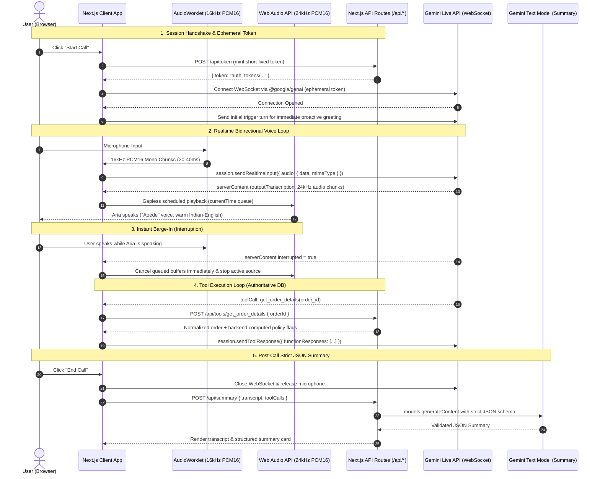

# Implementation Plan: "Aria" – AI Voice Customer Support Agent (Aura Skincare)

An end-to-end, production-ready implementation plan for building a browser-based AI Voice Customer Support Agent called **"Aria"** for the fictional D2C brand **"Aura Skincare"**, powered by the **Gemini Live API** (native speech-to-speech) and **Next.js**.

---

## 1. Architecture & System Design



---

## 2. Verified Documentation & Technical Parameters

Verified against official Google AI documentation (`ai.google.dev`, `@google/genai` SDK):

| Component | Specification | Description / Justification |
| :--- | :--- | :--- |
| **SDK** | `@google/genai` | Unified modern Google GenAI JavaScript/TypeScript SDK. |
| **Live API Model** | `gemini-2.5-flash-native-audio-preview-12-2025` | Primary model for native audio speech-to-speech with function calling. Fallback configured to `gemini-2.0-flash`. |
| **Summary Model** | `gemini-2.5-flash` | Text model with structured outputs (`responseSchema`) for strict post-call JSON summary. |
| **Voice Name** | `Aoede` | Natural, breezy prebuilt voice. Paired with system prompt accent instructions for Indian-English CX. |
| **Audio In** | 16-bit PCM Mono @ 16,000 Hz | Downsampled from browser input rate in an `AudioWorklet` processor; streamed in 20–40ms base64 chunks (`audio/pcm;rate=16000`). |
| **Audio Out** | 16-bit PCM Mono @ 24,000 Hz | Incoming base64 chunks converted to Float32 AudioBuffers and scheduled gaplessly via Web Audio API. |
| **Ephemeral Token** | `ai.authTokens.create` | Backend mints short-lived tokens with `uses: 1`, `newSessionExpireTime: 1m`, `expireTime: 30m`, and locked `liveConnectConstraints`. Master key stays server-side. |
| **Transcriptions** | `inputAudioTranscription: {}`, `outputAudioTranscription: {}` | Real-time text streams returned via `serverContent.inputTranscription` and `serverContent.outputTranscription`. |
| **Interruption** | `serverContent.interrupted === true` | Barge-in signal from Gemini server VAD to stop playback immediately. |

---

## 3. Project Directory Structure

```
c:/Users/athar/AI Voice CX Agent/
├── app/
│   ├── api/
│   │   ├── token/
│   │   │   └── route.ts            # Mints restricted ephemeral tokens
│   │   ├── tools/
│   │   │   └── get_order_details/
│   │   │       └── route.ts        # Order lookup & computed policy flags
│   │   └── summary/
│   │       └── route.ts            # Strict JSON post-call summary generator
│   ├── favicon.ico
│   ├── globals.css                 # Tailwind & custom aesthetic utilities
│   ├── layout.tsx                  # Root layout with Google Fonts (Inter)
│   └── page.tsx                    # Main single-page interactive application
├── components/
│   ├── AudioLevelMeter.tsx         # Real-time microphone level visualizer
│   ├── CallControls.tsx            # Start / End Call buttons & latency metric
│   ├── LiveStateIndicator.tsx      # Idle, Connecting, Listening, Thinking, Speaking, Error
│   ├── OrderHelperPanel.tsx        # Mock order cards (ORD-101..103) & sample phrases
│   ├── PostCallSummary.tsx         # Structured JSON viewer, Copy JSON, Download transcript
│   ├── TextTestModal.tsx           # Dev test mode: typed text regression testing
│   ├── ToolCallLog.tsx             # Collapsible tool execution drawer & timing
│   └── TranscriptView.tsx          # Real-time scrolling conversation turns
├── lib/
│   ├── audio/
│   │   ├── pcm-converter.ts        # PCM16 <-> Float32 & Base64 encoders/decoders
│   │   ├── player.ts               # 24kHz Web Audio gapless playback & barge-in stopper
│   │   ├── recorder.ts             # Microphone getUserMedia & worklet coordinator
│   │   └── worklet-processor.js    # AudioWorklet downsampler (any rate -> 16kHz PCM16)
│   ├── config.ts                   # Centralized model strings, voice, business rules
│   ├── live/
│   │   ├── gemini-live-client.ts   # Client-side Live API session manager
│   │   └── types.ts                # Session state & Live API event types
│   ├── orders/
│   │   ├── db.ts                   # Authoritative mock database
│   │   ├── normalizer.ts           # Speech-to-Order-ID normalizer ("o r d 1 0 1" -> "ORD-101")
│   │   ├── service.ts              # Business policy engine (computed policy flags)
│   │   └── types.ts                # Order & tool schemas
│   └── prompt.ts                   # Aria's persona, brand rules, guardrails, few-shot examples
├── tests/
│   ├── normalizer.test.ts          # Normalizer test cases
│   ├── orders-policy.test.ts       # Policy flags unit tests (boundary & edge cases)
│   └── summary.test.ts             # Post-call summary schema validation tests
├── .env.example
├── .gitignore
├── IMPLEMENTATION_PLAN.md          # This implementation plan
├── DEMO_SCRIPT.md                  # 3-5 minute demo video walkthrough script
├── README.md                       # Comprehensive documentation & "Tell Us How You Think"
├── package.json
├── tailwind.config.ts
├── tsconfig.json
└── vitest.config.ts
```

---

## 4. Phased Task List & Checklist

### Phase 1: Verification, Setup & Configuration
- [x] Initialize Next.js 15 App Router with TypeScript & Tailwind CSS in `./`.
- [x] Install dependencies: `@google/genai`, `lucide-react`, `vitest`.
- [x] Create `/lib/config.ts` holding:
  - `LIVE_MODEL_NAME = "gemini-2.5-flash-native-audio-preview-12-2025"` (with fallback `gemini-2.0-flash`)
  - `SUMMARY_MODEL_NAME = "gemini-2.5-flash"`
  - `VOICE_NAME = "Aoede"`
  - Audio constants: `INPUT_SAMPLE_RATE = 16000`, `OUTPUT_SAMPLE_RATE = 24000`
  - Business rules: Free shipping threshold ₹499 (exact 499 incurs ₹50 fee), COD maximum ₹2,500, Return window 7 days, Damage window 48 hours.
- [x] Setup `.env.example` with `GEMINI_API_KEY=` and ensure `.env.local` is in `.gitignore`.

### Phase 2: Authoritative Mock Orders & Policy Engine
- [x] Implement database in `/lib/orders/db.ts`:
  - `ORD-101`: Priya Sharma | Vitamin C Serum (30ml) | ₹699 | Out for Delivery | BlueDart - BD-982103 | Expected by 6 PM today
  - `ORD-102`: Rahul Verma | Hydrating Sunscreen SPF 50 | ₹499 | Delivered | Delhivery - DL-441029 | Delivered 14 days ago
  - `ORD-103`: Ananya Patel | Green Tea Face Wash + Toner | ₹850 | Processing | Ordered 3 hours ago | Eligible for cancellation
- [x] Implement order ID normalizer in `/lib/orders/normalizer.ts`:
  - Strips spaces, hyphens, and noise words.
  - Converts phonetic/spoken numbers (`"o r d one zero one"`, `"order one hundred and one"`, `"101"`, `"ord101"`) to canonical `"ORD-101"`.
- [x] Implement policy computation engine in `/lib/orders/service.ts`:
  - Authoritatively compute:
    - `can_cancel` (true ONLY for `Processing`)
    - `cancel_note` (e.g. For `Out for Delivery`, cannot cancel, customer may refuse at doorstep)
    - `delivered_days_ago`
    - `return_window_open` (true if delivered and $\le 7$ days)
    - `return_eligibility_note` (must be unopened, unused, original packaging)
    - `damage_report_window_open` ($\le 48$ hours)
    - `shipping_fee_applied` (true if total $\le 499$)
    - `cod_eligible` (true if total $\le 2500$)
- [x] Create API route: `POST /api/tools/get_order_details`.
- [x] Write unit tests in `/tests/normalizer.test.ts` and `/tests/orders-policy.test.ts`.

### Phase 3: Token Minting & Live Session Client
- [x] Create `/app/api/token/route.ts`:
  - In-memory rate limiting to prevent key misuse.
  - Call `client.authTokens.create` with `uses: 1`, `newSessionExpireTime: 1m`, `expireTime: 30m`.
  - Lock down constraints (`liveConnectConstraints`).
  - Return `{ token: token.name }`.
- [x] Create `/lib/live/gemini-live-client.ts`:
  - Manage WebSocket lifecycle via `@google/genai`.
  - Handle tool calls (`get_order_details`) by invoking backend route and replying with `sendToolResponse`.
  - Handle real-time audio chunk transmission and server response stream.
  - Emit clean events: `onStateChange`, `onAudioData`, `onTranscriptChunk`, `onToolCall`, `onInterrupted`, `onError`.

### Phase 4: Audio Pipeline (Worklet & Gapless Playback)
- [x] Create `/lib/audio/worklet-processor.js`:
  - Running on dedicated AudioWorklet thread.
  - Downsamples audio buffer from native hardware rate (44.1kHz/48kHz) to 16,000 Hz.
  - Converts Float32 to 16-bit signed PCM ArrayBuffer.
- [x] Create `/lib/audio/recorder.ts`:
  - Calls `navigator.mediaDevices.getUserMedia` with `echoCancellation`, `noiseSuppression`, `autoGainControl`.
  - Slices audio into 20–40ms chunks and emits base64 PCM16.
  - Calculates RMS level for UI volume meter.
- [x] Create `/lib/audio/player.ts`:
  - Web Audio `AudioContext` set to 24,000 Hz.
  - Gapless audio queue scheduler using `audioContext.currentTime`.
  - **Instant Barge-in**: `stopAll()` immediately stops playing buffers, disconnects nodes, resets playback pointer, and clears queue.

### Phase 5: Persona & Prompt Engineering
- [x] Implement system prompt in `/lib/prompt.ts`:
  - **Persona**: Aria, friendly, warm, professional Indian customer-support specialist at Aura Skincare. Default to English; match Hindi/Hinglish if spoken.
  - **Voice Rules**: 1–2 short sentences per turn, no markdown, no URLs, no bullet lists, read IDs digit-by-digit ("O R D, one zero one"), read prices naturally ("six hundred ninety-nine rupees").
  - **Single Question**: Ask only one question at a time.
  - **Tool Bridge**: Short natural acknowledgment ("Sure, let me check that for you") before invoking the tool to avoid dead air.
  - **Brand Knowledge Base**: Verbatim policies for shipping, returns, cancellations, COD.
  - **Guardrails**: No hallucinating policies or exceptions; no medical/dermatology advice; strict refusal of prompt injections; no prompt leakage.
  - **Few-Shot Examples**: 10 concrete dialogues for key edge cases (opened product 20 days ago, flight to Goa, invalid ID, missing ID, cancellation of Shipped order vs Processing order, ₹499 boundary, COD > 2500, unlisted discount request).

### Phase 6: Post-Call Structured JSON Summary
- [x] Create `/app/api/summary/route.ts`:
  - Accepts full conversation transcript and tool call log.
  - Uses `gemini-2.5-flash` with strict JSON schema.
  - Handles zero-turn calls (immediate hangup) and multiple intents.
  - Fallback summary builder in case of API rate limit.

### Phase 7: UI & State Machine
- [x] Implement `/app/page.tsx` and modular components:
  - **Header & Brand**: Aura Skincare branding with subtle warm gradient aesthetic.
  - **Call Controls**: Start Call (pre-warms AudioContext and fetches token) / End Call. Disabled states to prevent double-clicking.
  - **State Pill**: Clear badges for `Idle`, `Connecting`, `Listening`, `Thinking`, `Speaking`, `Error/Reconnecting`.
  - **Audio Level Meter**: Smooth live visual bar indicator of user speech volume.
  - **Test Orders Helper Panel**: Cards for `ORD-101`, `ORD-102`, `ORD-103` with click-to-copy buttons and clickable "Try saying" phrases.
  - **Live Transcript View**: Streaming turns for Customer and Aria with timestamps.
  - **Collapsible Tool Call Log**: Shows arguments, response flags, and round-trip execution latency.
  - **Post-Call Summary Modal / Card**: Formatted intent, resolution, policy badges, formatted summary, "Copy JSON" button, and "Download Transcript" (.txt/.json).
  - **Text Test Mode Toggle**: Hidden/dev modal for typing test prompts directly to verify prompts & tools without mic.

### Phase 8: Testing, Edge Cases & Scripted Regression
- [x] Run Vitest unit tests for:
  - Order normalizer (phonetic, spaced, dashed, digit words).
  - Policy computations (₹499 shipping boundary, 7-day return, 48-hour damage, Processing-only cancel).
- [x] Execute scripted regression test for the 11 core scenarios (ORD-101 tracking, ORD-102 return denial, ORD-103 cancel, ORD-101 cancel denial, ORD-999 not found, missing ID, opened product 20 days, flight to Goa, discount request, COD > 2500, shipping boundary).
- [x] Verify error handling:
  - Mic permission denied / device not found.
  - Browser WebSocket disconnect / network drops.
  - Rapid repeated user interruptions (barge-in stress test).
  - Cleanup on page close or tab unload.

### Phase 9: Deployment & Deliverables
- [x] Verify production build with zero errors: `npm run build`.
- [x] Create `README.md` with architecture diagram, guide, and Tell Us How You Think answers.
- [x] Create `DEMO_SCRIPT.md` with 3-5 minute video walkthrough script and submission approach note.
  - System architecture Mermaid diagram.
  - Quickstart and local setup instructions.
  - Tool and guardrail documentation.
  - Test scenario results matrix.
  - **"Tell Us How You Think"** section with detailed responses to:
    1. *Why this architecture and tech stack?*
    2. *The hardest part and how it was solved?*
    3. *What to improve with one more week?*
    4. *What changes at 1,000 conversations per day?*
- [ ] Create `DEMO_SCRIPT.md`:
  - 3–5 minute step-by-step video script with timestamps, visual cues, and narration.
- [ ] Create 2–3 sentence approach summary for submission email.

---

## 5. Review & Approval

You can freely inspect or modify this plan in [`IMPLEMENTATION_PLAN.md`](file:///c:/Users/athar/AI%20Voice%20CX%20Agent/IMPLEMENTATION_PLAN.md). Once ready, I will proceed to implement Phase 1.
